

# Burguer House · BurgerStock

**Controle de estoque da cozinha de uma hamburgueria, feito para o celular.**

Compra entra pela nota fiscal, venda sai pela ficha técnica, perda é registrada com um toque
e os relatórios mostram para onde o dinheiro está indo. Sem planilha.

> As telas abaixo usam o banco de demonstração do projeto, com 30 dias de movimento **fictício**
> sobre o catálogo real da loja (insumos, receitas e cardápio).

## O aplicativo

<table>
  <tr>
    <td align="center">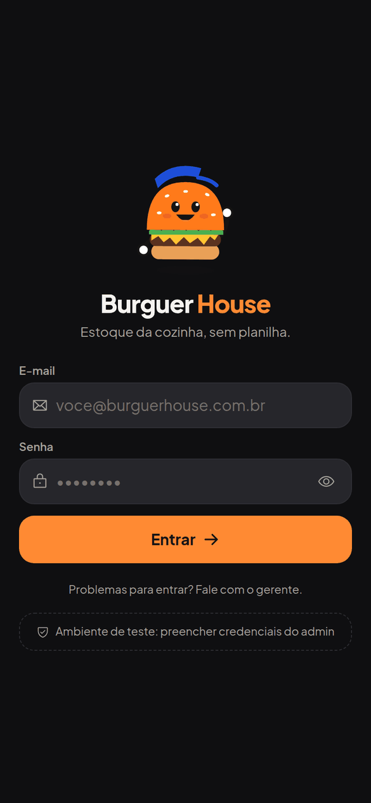</td>
    <td align="center">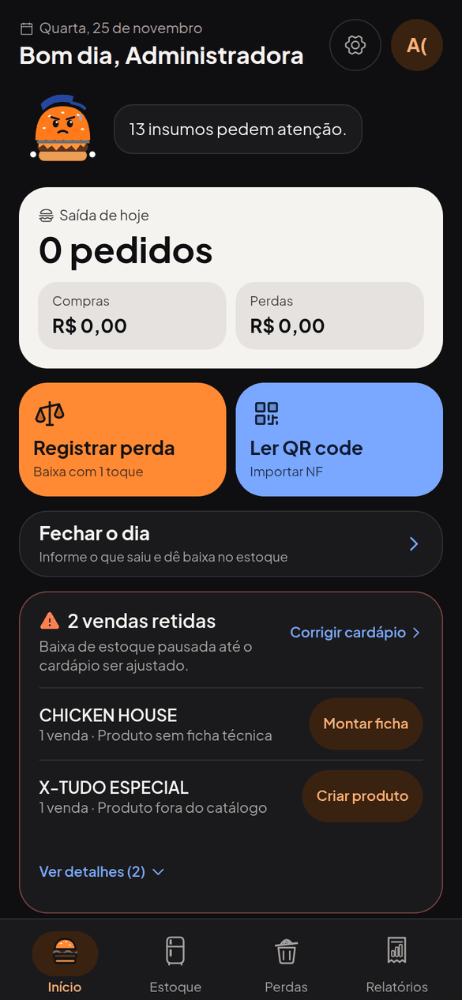</td>
    <td align="center">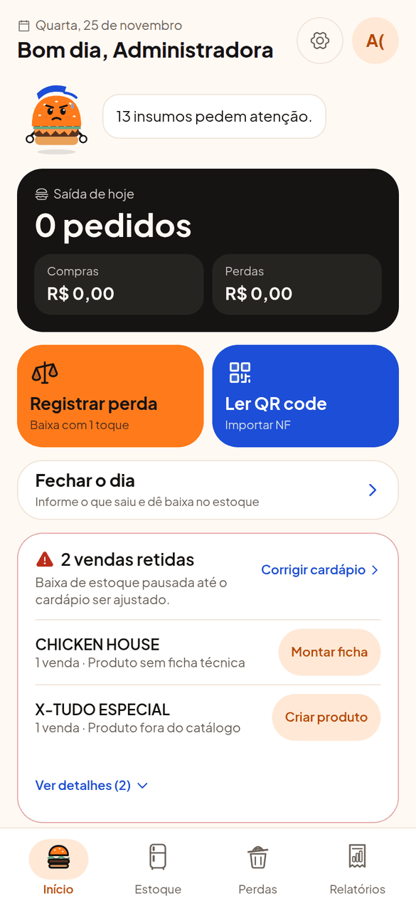</td>
  </tr>
  <tr>
    <td align="center"><b>Login</b></td>
    <td align="center"><b>Início</b> alertas, atalhos e vendas retidas</td>
    <td align="center"><b>Tema claro</b> claro, escuro ou o do sistema</td>
  </tr>
</table>

### Estoque

<table>
  <tr>
    <td align="center">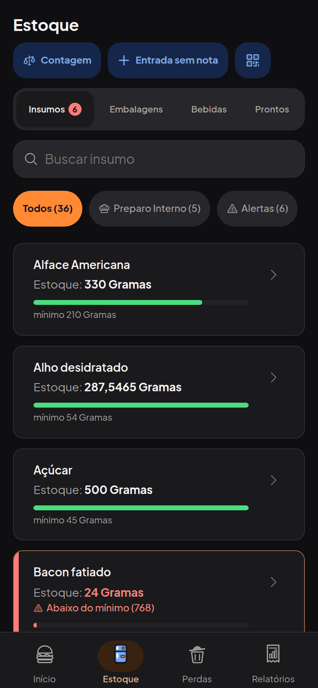</td>
    <td align="center">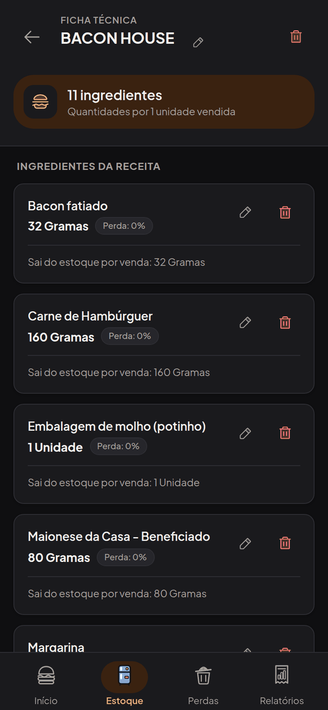</td>
    <td align="center">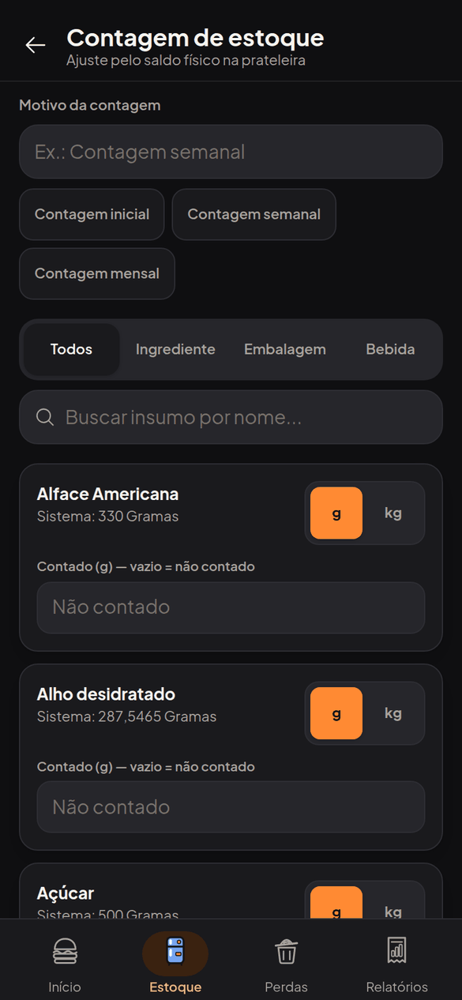</td>
  </tr>
  <tr>
    <td align="center"><b>Insumos</b> saldo, estoque mínimo e alertas</td>
    <td align="center"><b>Ficha técnica</b> o que cada lanche consome</td>
    <td align="center"><b>Contagem</b> ajuste pelo que está na prateleira</td>
  </tr>
</table>

### Entradas e saídas

<table>
  <tr>
    <td align="center">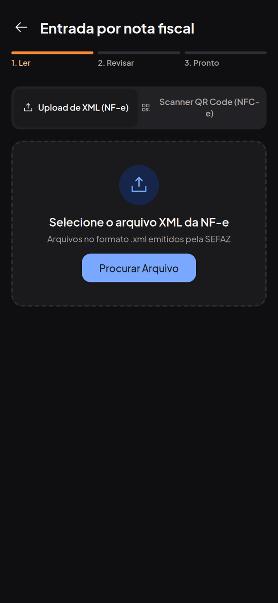</td>
    <td align="center">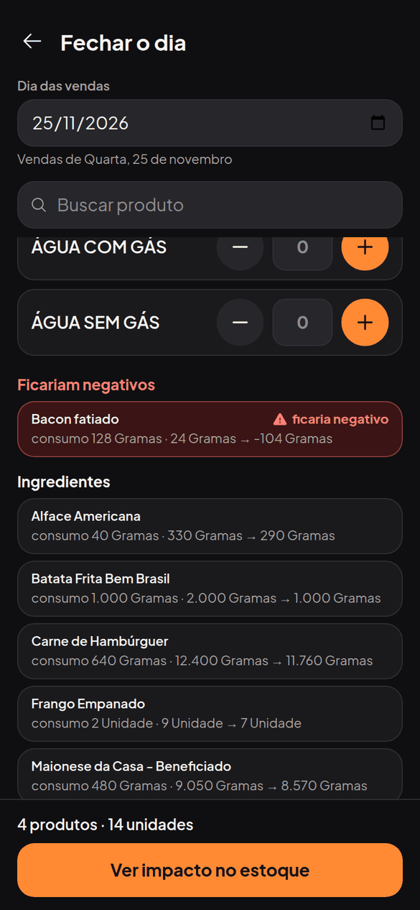</td>
    <td align="center">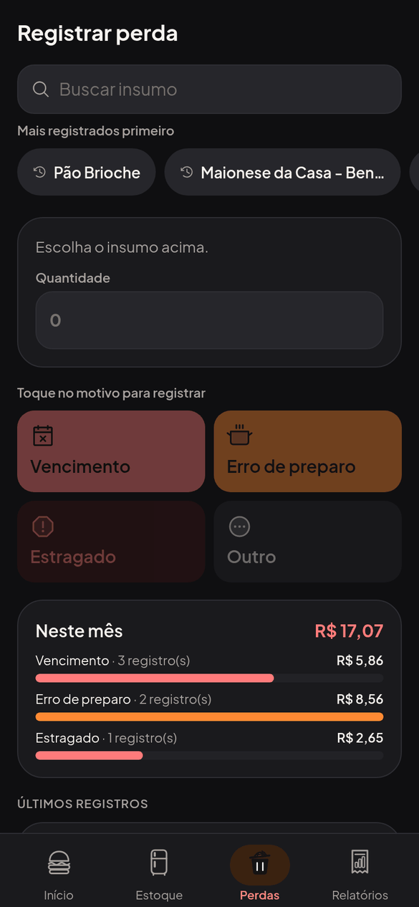</td>
  </tr>
  <tr>
    <td align="center"><b>Nota fiscal</b> QR code da NFC-e ou XML da NF-e</td>
    <td align="center"><b>Fechar o dia</b> prévia do impacto antes da baixa</td>
    <td align="center"><b>Perdas</b> vencimento, erro de preparo, estragado</td>
  </tr>
</table>

### Relatórios

<table>
  <tr>
    <td align="center">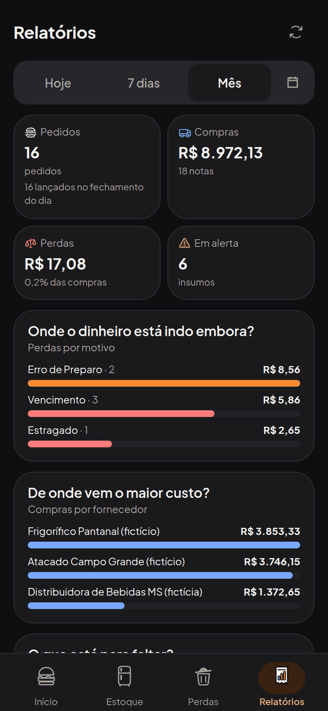</td>
    <td align="center">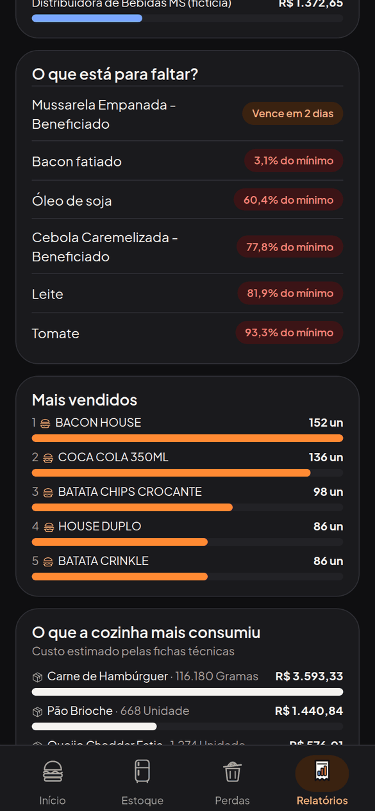</td>
  </tr>
  <tr>
    <td align="center"><b>Resumo do período</b> pedidos, compras, perdas e fornecedores</td>
    <td align="center"><b>O que vai faltar e o que mais sai</b> mais vendidos e custo do consumo</td>
  </tr>
</table>

## Como funciona

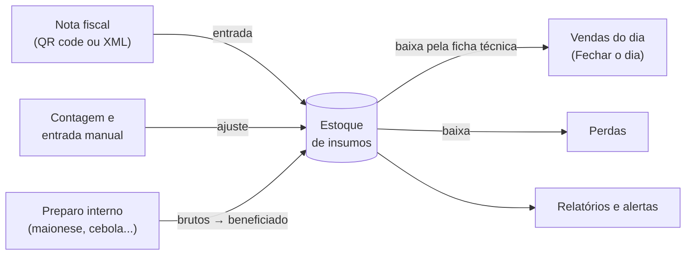

1. **A compra entra pela nota.** O app lê o QR code da NFC-e (consulta a página pública da SEFAZ) ou o
   XML da NF-e, sugere qual insumo corresponde a cada item da nota e, depois da conferência, soma o
   estoque e atualiza o custo. A mesma nota não entra duas vezes.
2. **A venda sai pela ficha técnica.** Cada lanche do cardápio tem a lista de insumos que consome, com
   fator de perda. No **Fechar o dia** a equipe informa quantas unidades de cada produto saíram e o app
   mostra o impacto em cada insumo, inclusive o que ficaria negativo, antes de dar baixa.
3. **O que é feito na cozinha também conta.** Receitas da casa (maionese, cebola caramelizada, empanados)
   consomem os insumos brutos e geram o item beneficiado, com validade.
4. **Perda é registrada com um toque**, com o motivo, e entra nos relatórios.
5. **Alertas na tela inicial:** insumos abaixo do mínimo, itens perto do vencimento e vendas retidas
   (produto sem ficha técnica ou fora do cardápio) que esperam um ajuste para baixar o estoque.
6. **Relatórios** por dia, 7 dias, mês ou período: compras por fornecedor, perdas por motivo, o que está
   para faltar, mais vendidos e o custo estimado do que a cozinha consumiu.

O acesso tem papéis: o **admin** faz tudo; **gerente** e **operador** consultam em modo somente leitura.
O app pode ser instalado na tela inicial do celular.

## Stack

| Camada | Tecnologias |
|---|---|
| **Frontend** | React 19, TypeScript, Vite, Tailwind CSS 4, Motion (animações), Recharts (gráficos), Phosphor Icons, html5-qrcode (leitor de QR), Axios |
| **Backend** | Node.js, Fastify 5, TypeScript, Zod (validação), JWT (@fastify/jwt), bcryptjs, fast-xml-parser (XML da NF-e), Cheerio (página da NFC-e) |
| **Banco** | PostgreSQL com Prisma 7 (`@prisma/adapter-pg`) |
| **Testes** | Vitest e Testing Library (unitários, integração com Postgres real), Stryker (testes de mutação) |
| **Infra** | Docker Compose no desenvolvimento, GitHub Actions (CI e agendamentos), Render (API e site) e Neon (Postgres) |

Mais detalhes da arquitetura, dos fluxos e do contrato da API em [`docs/`](docs/README.md).
