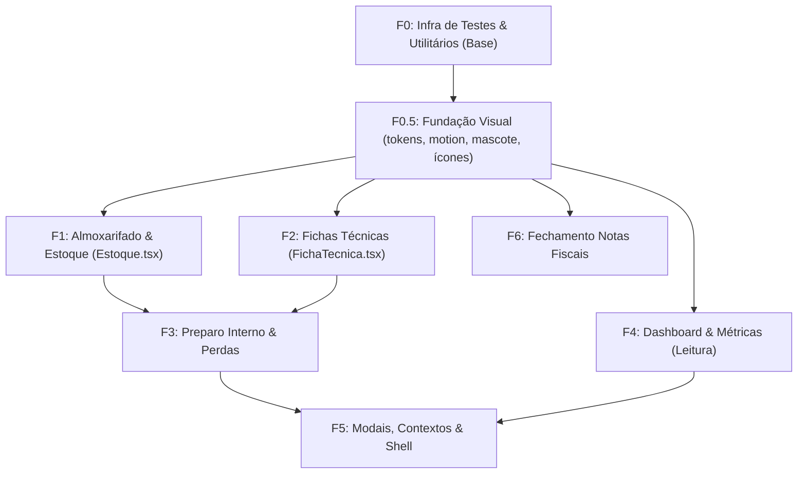

# Plano de Endurecimento e Revisão do Frontend (Burguer House)

## Objetivo
Revisar todas as telas e componentes da aplicação frontend (`frontend/`), linha a linha, aplicando a metodologia de endurecimento de software (skill `module-hardening`).
Cada suspeita deve ser comprovadamente reproduzida antes do ajuste, cada correção deve possuir teste automatizado correspondente, e a eficácia de cada teste deve ser comprovada via teste de mutação.

---

## Regras de Escopo e Governança (`AGENTS.md`)
- **Dono:** Agente FRONT. Modificações de código limitadas estritamente a `frontend/`, `docs/PLANO_FRONTEND.md` e registros de pendências/demandas em `docs/requests.md`.
- **Backend & Banco Intocados:** Inconsistências de backend ou necessidades de schema devem ser documentadas em `docs/requests.md` sem edição direta de código backend ou Prisma schema.
- **Contrato:** Alinhamento estrito com `docs/api.md`. Divergências entre interface e contrato constituem achados a documentar/corrigir.
- **Git & Qualidade:**
  - Um Pull Request independente por fase/bloco (`F0` a `F6`).
  - Commits seguindo Conventional Commits com escopo (`fix(frontend):`, `test(frontend):`, `feat(frontend):`).
  - Cada PR deve ter `npm --prefix frontend run lint`, `npm --prefix frontend test` e `npm --prefix frontend run build` 100% verdes antes do merge.

---

## Achados Prévios Identificados

| ID | Severidade | Achado | Evidência | Destino |
|:---|:---:|:---|:---|:---|
| **A1** | 🔴 Crítico | A validade de item beneficiado reinicia a cada baixa de estoque. Frontend (`Estoque.tsx:23`) e backend (`dashboard.service.ts:66`) calculam a expiração somando `validadeDias` ao `atualizadoEm`. Como o Prisma dispara `@updatedAt` em qualquer alteração (perda, venda consolidada ou edição cadastral), um molho vencido volta a constar como fresco/válido após qualquer movimentação. | Reproduzido: decrement de 10g alterou `atualizadoEm` de 13:32:18 para 13:32:20, postergando o vencimento. | Registrado em `docs/requests.md` (requer lote ou `ultimoPreparoEm` conservador no schema e cálculo unificado no backend). |
| **A2** | 🟡 Médio | Ausência de bloqueio contra duplo clique em ações mutativas. Salvar insumo, criar produto e adicionar ingrediente não possuem flag/trava de envio ativa (`submitting`/`loading`), permitindo criação de registros duplicados em cliques rápidos. | `Estoque.tsx:353` sem propriedade `disabled={enviando}` ou controle de concorrência. | Fases F1 e F2 via hook `useEnvio`. |
| **A3** | 🟡 Médio | Mensagens detalhadas de validação exibidas genericamente como `"Dados inválidos"`. O backend Fastify/Zod devolve os detalhes em `issues[0].message`, mas o client lê apenas `error.response.data.message`. | Leitura de `backend/src/infra/http/error_handler.ts:18` vs `frontend/src/lib/api.ts:36`. | Fase F0 (ajuste central na função `mensagemDeErro`). |
| **A4** | 🟢 Menor | Formatação monetária fora do padrão brasileiro pt-BR (utilização de `toFixed(2)` gerando ex.: `R$ 1234.50` sem separador de milhar). | `Dashboard.tsx:244`, `Inicio.tsx:212`. Ausência de `Intl.NumberFormat`. | Fases F0 e F4 (`lib/formatar.ts`). |
| **A5** | 🟡 Médio | Fórmulas de cálculo duplicadas entre frontend e backend com potencial de divergência: cálculo de desconto com perda (`FichaTecnica.tsx:418`), prévia de consumo de insumos brutos (`PreparoInterno.tsx:122`) e dias de validade (`A1`). | Leitura estática de código. | Testes de paridade nas fases F2 e F3; cálculo de validade migrado para fonte única no backend via `requests.md`. |

---

## Ordem de Execução dos Pull Requests

### F0: Infraestrutura de Testes e Utilitários Compartilhados (Pré-requisito)
- **Objetivo:** Estabelecer o arcabouço para viabilizar testes de componentes completos e desacoplados.
- **Entregáveis:**
  1. `src/test/render.tsx`: Utilitário `renderComProviders` encapsulando `AuthContext`, `FeedbackContext`, `ThemeContext` e mock do `lib/api`.
  2. Fixtures completas em `src/test/fixtures/` espelhando `docs/api.md` (respostas 200/201 e erros 400, 404 e 409 com estruturas reais de payload).
  3. `src/lib/formatar.ts`: Funções `formatarMoeda(valor)` e `formatarQuantidade(valor, unidade)` utilizando `Intl.NumberFormat('pt-BR')`, com cobertura de testes unitários.
  4. `src/lib/api.ts`: Atualização de `mensagemDeErro(error)` para extrair prioritariamente `issues[0].message` quando presente (solução do achado **A3**).
  5. `src/hooks/useEnvio.ts`: Hook customizado com trava atômica por `useRef` impedindo execução concorrente ou disparos duplicados por duplo clique (**A2**).

### F0.5: Fundação Visual (Identidade e Movimento)
- **Especificação completa:** [`docs/F05_FUNDACAO_VISUAL.md`](F05_FUNDACAO_VISUAL.md). **Referência visual:** [`docs/design/referencia-visual.html`](design/referencia-visual.html).
- **Resumo:** tokens de cor claro/escuro (laranja, preto, branco e azul), `motion` com transição entre abas, `Sheet`/`Toast`/`ConfirmDialog` por trás da API atual do `FeedbackContext`, ícones Phosphor no lugar do lucide, ícones próprios da barra inferior (estilo "adesivo") e o mascote hambúrguer com 6 humores.
- **Não reescreve telas.** Cada fase F1–F6 passa a ter um segundo commit `style(frontend)` migrando a sua tela para os tokens (regra na especificação). O redesenho da tela inicial entra no F4.
- **Esboços de todas as telas:** [`docs/design/telas.html`](design/telas.html) (abra no navegador; `telas.html#perdas` ou `#perdas:escuro` abre direto numa tela). O commit `style(frontend)` de cada fase segue o esboço da sua tela, não só os tokens: layout, hierarquia e textos. Onde o esboço depende de backend ou de decisão pendente, a nota ao lado da tela diz o que fazer até lá.

### F1: Almoxarifado e Cadastro de Insumos (`Estoque.tsx` - 625 linhas)
- **Cenários a Cobrir e Testar:**
  - Trava de duplo clique nos botões "Salvar Insumo" e "Criar Produto" usando `useEnvio`.
  - Troca rápida de abas (isolamento de estado `carregando` por aba, evitando vazamento visual).
  - Validação de entrada: input de fator de perda limitado a 100% (`max={100}` e tratamento amigável de 400).
  - Tratamento do erro `409 Conflict` na alteração de unidade de medida com movimentações associadas.
  - Tratamento do erro `409 Conflict` na colisão de nomes de produto, exibindo o `produtoConflito` e permitindo navegar/visualizar o produto existente.
  - Exclusão de insumo com vínculos (resposta 409).
  - Regra de interface: campo `validadeDias` desabilitado/limpo quando "produzido internamente" for desmarcado.
  - Filtro da aba "Alertas de Estoque": comportamento quando `estoqueMinimo = 0`.
  - Validade de insumos beneficiados: consumir os campos de validade calculados diretamente pelo backend (`venceEm`, `diasRestantes`, `statusValidade`) conforme solicitação em `docs/requests.md`, eliminando a duplicação de cálculo no frontend e tratando `null` como validade desconhecida.
  - Contrato: garantia comprovada de que a edição cadastral (PUT) não envia `estoqueAtual` no payload.

### F2: Engenharia de Cardápio (`FichaTecnica.tsx` - 427 linhas)
- **Cenários a Cobrir e Testar:**
  - Bloqueio e feedback ao tentar adicionar ingrediente duplicado na mesma ficha (409).
  - Validação de quantidades: bloqueio de valores negativos, zero ou formatação inválida com vírgula.
  - Renomeação de produto com tratamento dos status 400 (nome vazio/sem alfanuméricos) e 409 (colisão de nomes).
  - Exclusão do produto com redirecionamento limpo para listagem.
  - Tratamento de corrida com insumo excluído em outra aba/sessão (404).
  - **Teste de Paridade (A5):** Confrontar o cálculo de desconto com perda da tela com o resultado retornado por `planejarConsolidacao`.

### F3: Chão de Fábrica (`PreparoInterno.tsx` e `Perdas.tsx` - 574 linhas)
- **Cenários a Cobrir e Testar:**
  - Corrida de saldo: estoque do insumo bruto alterado entre a prévia e a confirmação de "Produzir" (exibição da mensagem retornada pelo backend).
  - Prevenção e feedback para sub-ficha circular ou insumo bruto idêntico ao beneficiado.
  - Registro de perda com quantidade superior ao estoque atual (exibição de alerta ou bloqueio conforme contrato).
  - Validação estrita de motivos de perda.
  - Exibição de resumo mensal de perdas e comportamento na virada do mês no fuso de MS.
  - **Teste de Paridade (A5):** Comparação do cálculo de prévia de consumo de insumos com `producao.service.ts`.

### F4: Inteligência do Negócio (`Dashboard.tsx` e `Inicio.tsx` - 925 linhas)
- **Cenários a Cobrir e Testar:**
  - Formatação monetária padronizada com `Intl` (**A4**).
  - Filtro por período personalizado: datas válidas `yyyy-mm-dd`, validação de limites (início > fim, período > 366 dias) e exibição das mensagens de erro do backend.
  - Resiliência matemática: tratamento de divisões por zero ou percentuais em dias com faturamento nulo.
  - Estados explícitos de carregamento (skeletons), dados vazios e falhas de conexão.
  - Prevenção de *race condition* em trocas rápidas de filtro (resposta de requisição antiga sobrescrevendo seleção recente).

### F5: Shell, Modais e Sessão (~1.300 linhas)
- **Cenários a Cobrir e Testar:**
  - `PerfilModal.tsx`: Atualização segura de token após troca de senha e sincronização de encerramento de sessão anterior.
  - `ConfiguracoesModal.tsx`: Proteção de chamadas a `localStorage` com `try/catch` para navegação anônima ou ambientes com cookies/storage bloqueados.
  - `FeedbackContext.tsx`: Garantir resolução de promises de `confirmar()` mesmo se o componente for desmontado durante a interação.
  - Navegação e Guards: `ThemeContext`, `App.tsx` (rotas protegidas vs públicas), `Header`, `BottomNav`, `Login`.

### F6: Entrada de Mercadorias (`ImportarNotaFiscal.tsx` - 970 linhas)
- **Cenários a Cobrir e Testar:**
  - Fechamento de lacunas remanescentes dos PRs #45 e #46.
  - Tratamento de XML corrompido, chave de acesso duplicada e vinculação inteligente de insumos.
  - Conversão de unidades tributárias e validações de data de emissão.

---

## Checklist de Qualidade Obrigatório (Aplicado a Toda Tela)
- [ ] **Trava de Envio:** Uso de `useEnvio` em todas as ações de escrita (POST, PUT, DELETE) com feedback visual de carregamento.
- [ ] **Tratamento de Exceções:** Todo bloco `catch` trata e exibe a mensagem de erro específica do backend (`issues[0].message` ou `message`). Nenhum catch silencioso.
- [ ] **Paridade de Contrato:** Todos os endpoints e payloads utilizados na página existem e respeitam estritamente o `docs/api.md`.
- [ ] **Validação Numérica:** Tratar explicitamente strings vazias, zero, valores negativos, separadores decimais (ponto/vírgula) e números extremos. Exibição padronizada em pt-BR.
- [ ] **Ciclo de Vida:** Cancelamento/ignorar respostas de requisições pendentes se o componente for desmontado (`AbortController` ou flag `isMounted`).
- [ ] **Mobile & Usabilidade:** Alvos de toque acessíveis (mínimo 44x44px), `inputMode="decimal"` ou `inputMode="numeric"`, contraste e compatibilidade com modo escuro.

---

## Critério de Conclusão ("Definição de Pronto" por PR)
1. **Registro de Leitura:** Faixa de linhas e arquivos lidos documentados explicitamente na descrição do PR.
2. **Evidência Obrigatória:** Todo achado 🔴/🟡 deve ser acompanhado de teste unitário que falhava antes da correção e passa após a correção, com mutação correspondente comprovada.
3. **Build e Testes Verdes:** `npm --prefix frontend run lint`, `npm --prefix frontend test` e `npm --prefix frontend run build` sem avisos ou falhas.
4. **Backend Preservado:** Zero edições no diretório `backend/`. Quaisquer demandas registradas como solicitação em `docs/requests.md`.

---

## Pendências depois da demonstração (registrado em 10/11/2026)

A migração visual de todas as telas para os esboços (`docs/design/telas.html`) foi feita nos PRs #66–#69 com **foco visual**, sem os commits `fix` de endurecimento previstos para F4–F6. Ficam pendentes:

- ~~**F4 (Início e Relatórios):** endurecimento completo; período personalizado em Relatórios (o esboço prevê o ícone de calendário; o backend aceita `dataInicio`/`dataFim`).~~ **Concluído em 11/11/2026** (branch `fix/frontend-f4-endurecimento`): endurecimento das duas telas pelo checklist (mensagem do backend no erro, resposta malformada, alertas com validade primeiro e presença/ausência de `diasRestantesValidade`/`vencido`, perdas zeradas, pt-BR, 44px, `useEnvio` na recarga, corrida entre períodos e desmontagem provadas por teste) e período personalizado com validação no front (datas válidas, início ≤ fim, até 366 dias). Fica em aberto: a data/saudação e o "hoje" do Início não viram à meia-noite com a tela aberta (sem relógio); ajustes de contrato do dashboard em `docs/requests.md` ("Ajustes de `GET /api/dashboard/resumo` vistos no endurecimento F4").
- ~~**F5 (shell e sessão):** revisão de `PerfilModal`, `ConfiguracoesModal`, `ThemeContext`, `App`; o `confirmar()` do `FeedbackContext` com dois diálogos simultâneos (o segundo sobrescreve o primeiro).~~ **Concluído** (branch `fix/frontend-f5-endurecimento`): revisão linha a linha de `lib/api.ts`, `FeedbackContext`, `AuthContext`, `ThemeContext`, `ConfiguracoesModal`, `PerfilModal`, `BottomNav`, `App` e `Login`. Corrigidos com teste que falhava antes: `confirmar()` em fila e resolvido (false) no desmonte; `localStorage` protegido em tema/sessão/interceptor (`lib/armazenamento.ts`, com cópia em memória); 401 de requisição feita com token antigo (troca de senha) ou após logout não derruba a sessão nova; `/auth/me` obsoleto ignorado e 404 encerra a sessão; troca de senha que responde após logout não regrava o token; cache de usuário inválido descartado; `useEnvio` e `mensagemDeErro` no Perfil e no Login; timers do Perfil cancelados; estado do shell zera a cada sessão. Ficam registrados (não corrigidos): o som do scanner desligado não vale com armazenamento bloqueado (`lib/bipScanner.ts` relê o storage; fica para quem endurecer a nota fiscal), alvo de toque do switch de som com 28px de altura, e diálogo de confirmação aberto que sobrevive ao fim da sessão.
- ~~**F6 (nota fiscal):** endurecimento da `ImportarNotaFiscal.tsx` (erros da SEFAZ, chave duplicada, conversões, duplo clique na confirmação) e o layout do passo 2 mais próximo do esboço (vínculo em lista, "Escolher insumo" destacado).~~ **Concluído em 11/11/2026** (branch `fix/frontend-f6-endurecimento`): regras extraídas para `lib/notaFiscal.ts`/`lib/qrImagem.ts`; fator de conversão com vírgula e bloqueio de vazio/zero/negativo/infinito; item sem vínculo ou com insumo excluído bloqueia a confirmação; conversão 1:1 incerta pede confirmação; XML acima de 500 KB recusado antes do envio; data de emissão exibida (e marcada quando aproximada) sem inventar a de hoje; falha ao carregar insumos com "Tentar novamente"; leitura repetida da câmera e câmera ligada após sair da tela corrigidas; `useEnvio` na confirmação; AudioContext do bip fechado; passo 2 em lista com "Escolher insumo" destacado. Fica para o backend: validação/flag da data de emissão (`docs/requests.md`, 11/11/2026).
- **Estoque:** editar e excluir insumo dentro do Sheet (o esboço previa; ficaram como ícones no card para não mudar o fluxo dos testes do F1).
- **Dependência:** o `recharts` não é mais usado em nenhuma tela; remover do `package.json` com aprovação.
- **Decisões do dono:** A1 (validade dos beneficiados), ajuste de inventário, matriz de RBAC (inclui se o operador vê valores em R$ na tela inicial e em Perdas).
