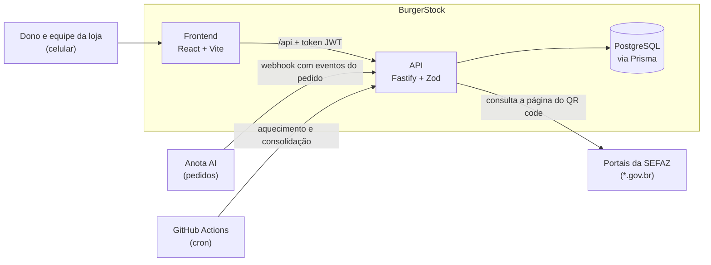
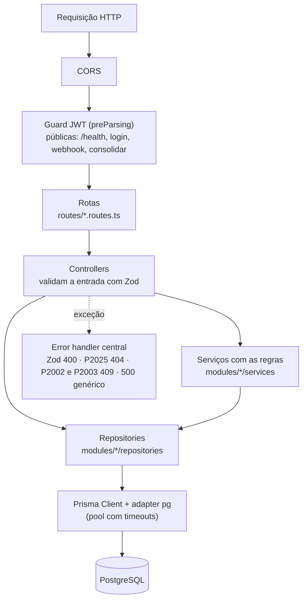
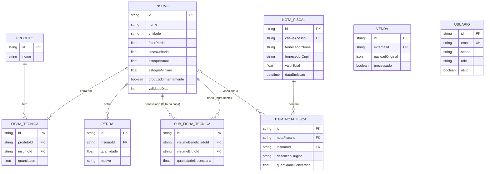
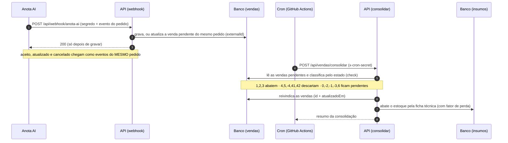
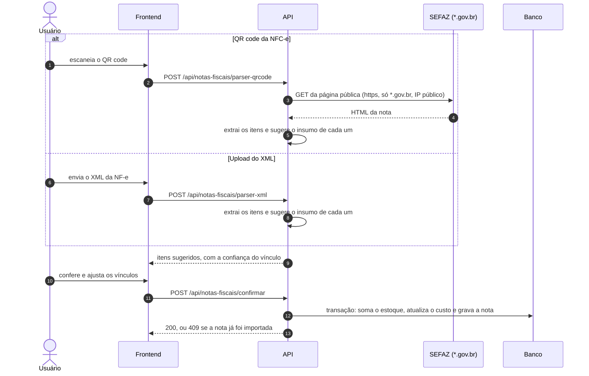
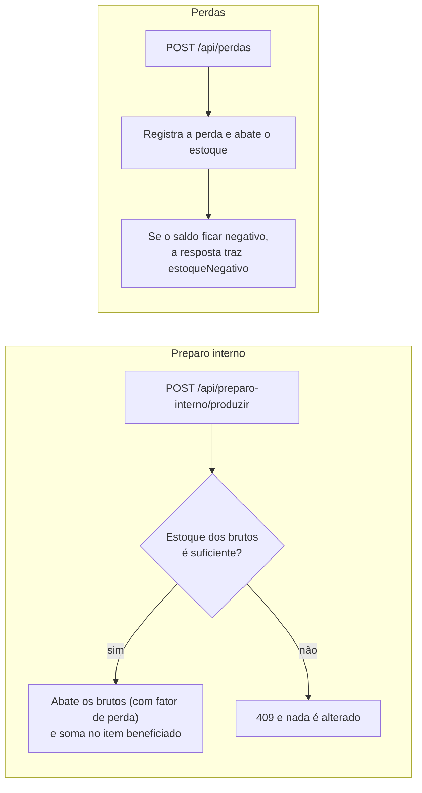
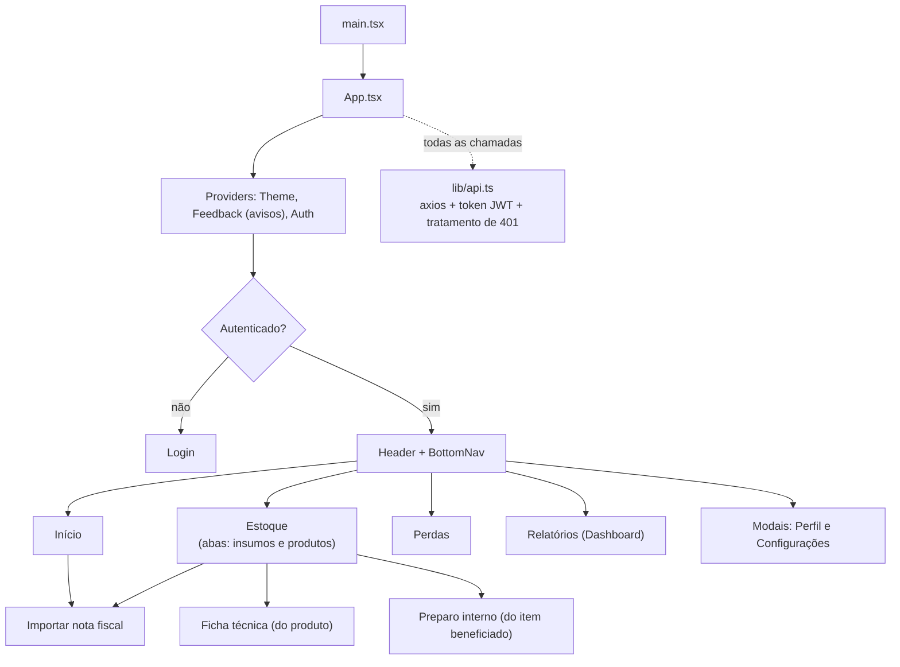
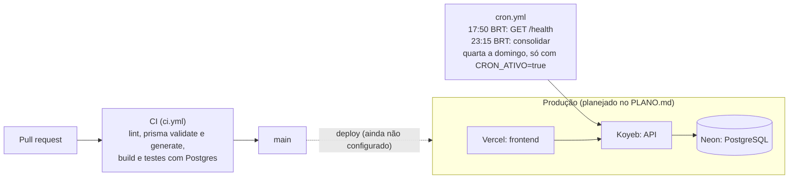

# Arquitetura do BurgerStock

Visão do que **existe hoje no código** (branch `main`). A hospedagem em nuvem aparece como *planejada*, porque o `PLANO.md` a prevê mas ainda não há deploy configurado. Os diagramas estão em Mermaid: o GitHub e o Obsidian os desenham sozinhos.

> Mudou código que altera um diagrama? Atualize este arquivo no mesmo PR. O contrato das rotas fica em [api.md](api.md).

## 1. Contexto: quem fala com quem

| Peça | Papel | Observação |
|---|---|---|
| Frontend (`frontend/`) | Telas mobile-first para estoque, perdas, notas e relatórios | Em dev chama `/api` e o Vite repassa ao backend; em produção usa `VITE_API_URL` |
| API (`backend/`) | Regras de negócio, autenticação e acesso ao banco | Escuta na porta de `PORT` (padrão 3000) e encerra de forma limpa em `SIGINT` e `SIGTERM` |
| PostgreSQL | Dados do estoque, vendas, notas e usuários | Schema e migrations em `backend/prisma/` |
| Anota AI | Origem dos pedidos | Chama o webhook; o formato real do corpo ainda não foi confirmado (ver [requests.md](requests.md)) |
| SEFAZ | Página pública da NFC-e lida pelo QR code | Só hosts `*.gov.br`, em https |
| GitHub Actions | CI e agendamentos | Ver seção 7 |

## 2. Backend por dentro

**Rotas** (prefixo `/api`, exceto `/health`):

| Prefixo | O que faz |
|---|---|
| `/auth` | login, perfil, troca de senha (login limitado a 10 tentativas por IP a cada 15 min) |
| `/insumos` | cadastro de insumos e alertas de estoque mínimo |
| `/produtos` e `/fichas-tecnicas` | produtos e a receita (insumos por produto) |
| `/preparo-interno` | sub-fichas e produção de itens beneficiados |
| `/perdas` | registro de perdas e resumo mensal |
| `/notas-fiscais` | leitura de QR code e XML, confirmação da entrada, listagem |
| `/dashboard` | resumo agregado por período |
| `/webhook/anota-ai` e `/vendas/consolidar` | entrada de vendas e baixa de estoque |

**Segurança em uma linha:** tudo exige JWT, exceto `/health`, o login e as duas rotas com segredo próprio (`ANOTAAI_WEBHOOK_SECRET` no webhook e `CRON_SECRET` na consolidação). O servidor não sobe sem `JWT_SECRET`.

## 3. Modelo de dados

- `VENDA` guarda o payload bruto da Anota AI e não se liga às outras tabelas: a ligação é feita **na consolidação**, pelo nome do produto vendido.
- `motivo` da perda: `VENCIMENTO`, `ERRO_PREPARO`, `ESTRAGADO` ou `OUTRO`. `role` do usuário: `ADMIN`, `GERENTE` ou `OPERADOR` (as permissões por role ainda não são aplicadas).
- A `chaveAcesso` única da nota é o que impede importar a mesma nota duas vezes.
- Só os campos principais estão no diagrama; a lista completa está em `backend/prisma/schema.prisma`.

## 4. Fluxos principais

### 4.1 Venda: do pedido ao estoque

Por que é assim:
- O webhook **grava antes de responder**: se o banco falhar, devolve 500 e a Anota AI pode reenviar.
- Como o mesmo pedido gera vários eventos, o **último estado vale** enquanto a venda não foi consolidada.
- A consolidação **reivindica** as vendas dentro da transação: duas execuções simultâneas não descontam o estoque em dobro, e um cancelamento que chegue no meio faz a leitura ser refeita.
- Com `ANOTAAI_MODO_SOMBRA=true`, o webhook registra os eventos com log operacional livre de PII e `POST /api/vendas/consolidar` roda apenas o planejamento em *dry-run* (`modoSombra: true`), sem abater estoque nem marcar `processado`. O script `npm --prefix backend run exportar:fixtures` exporta esses payloads anonimizados para validação com `replay:vendas`. Ver guia completo em [MODO_SOMBRA_ANOTAAI.md](MODO_SOMBRA_ANOTAAI.md).

### 4.2 Nota fiscal: da compra ao estoque

O vínculo item da nota com insumo tenta, nesta ordem: histórico de vínculos anteriores, nome exato, sinônimos e similaridade por palavras. Se a SEFAZ não responder, o sistema devolve só a chave de acesso e o usuário segue pelo XML ou digita os itens.

### 4.3 Produção interna e perdas

## 5. Frontend

- O token fica no `localStorage`. Um 401 em qualquer chamada encerra a sessão. Erro de rede ao abrir o app **não** derruba a sessão (usa o último usuário salvo).
- `pages/Insumos.tsx` existe, mas **nenhuma tela o importa**: o cadastro de insumos acontece em `Estoque.tsx`.

## 6. Decisões de arquitetura que valem lembrar

| Decisão | Motivo |
|---|---|
| Transações para tudo que mexe em estoque | Duas operações simultâneas não podem corromper o saldo |
| Baixa condicional na produção interna | Se o estoque acabar no meio, tudo é desfeito com 409 |
| Estoque negativo permitido na consolidação e nas perdas | A venda e a perda já aconteceram; o sistema avisa em vez de bloquear |
| `chaveAcesso` única como chave de idempotência da nota | Reimportar a mesma nota não duplica o estoque |
| Validação com Zod nos controllers e erros tratados em um só lugar | Respostas de erro consistentes e sem vazar detalhes internos |
| Cron externo (GitHub Actions) em vez de agendador dentro da API | Em plano gratuito a API hiberna; o agendamento externo a acorda |

## 7. Infraestrutura e CI

- Os horários do `cron.yml` estão em UTC no arquivo (Brasília é UTC-3): 23:15 BRT cai às 02:15 UTC do dia seguinte.
- Variáveis de ambiente por componente estão em `backend/.env.example` e `frontend/.env.example`. Segredos de produção (`JWT_SECRET`, `ANOTAAI_WEBHOOK_SECRET`, `CRON_SECRET`) nunca vão para o Git.
